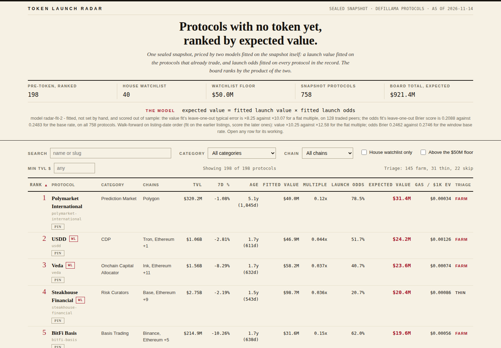
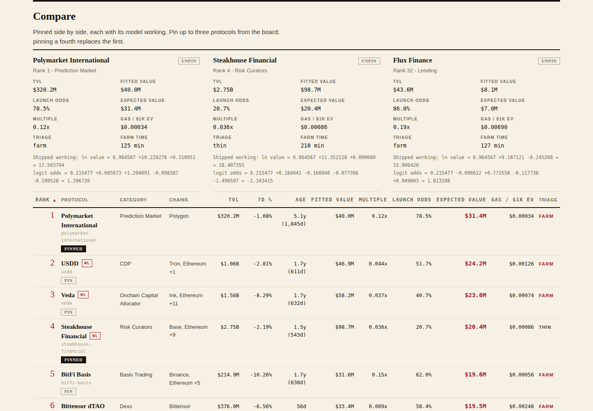
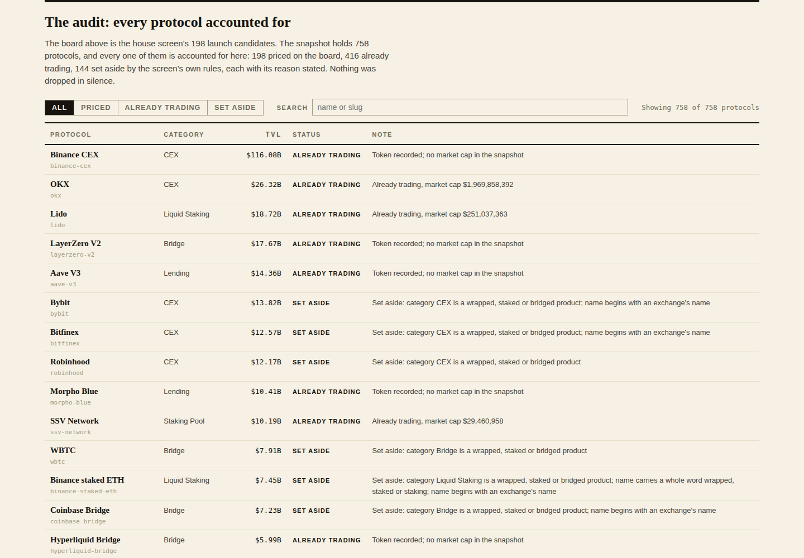
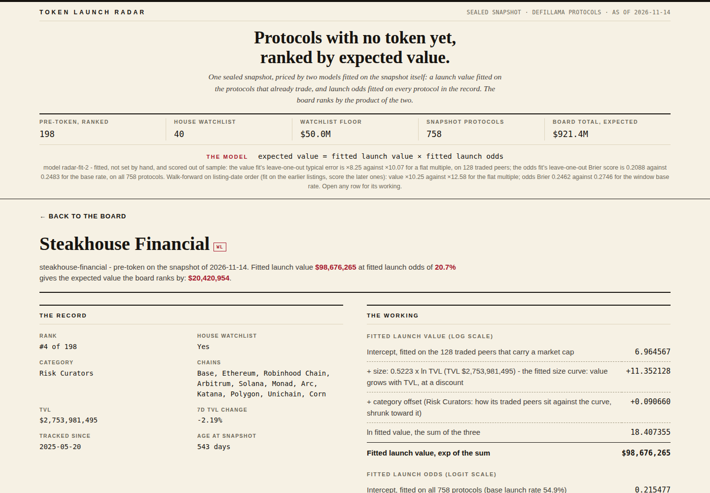

# Token Launch Radar

[](https://make.fun/bounty/token-radar-01?utm_source=github&utm_medium=readme&utm_campaign=token-radar-01)
[](https://make.fun/bounty/token-radar-01/leaderboard?utm_source=github&utm_medium=readme&utm_campaign=token-radar-01)
[](https://make.fun/bounty/token-radar-01?utm_source=github&utm_medium=readme&utm_campaign=token-radar-01)

Most protocols that will ever launch a token have not launched one yet. This is a radar for them. It takes one sealed DefiLlama snapshot - 758 protocols, as of 2026-11-14 - finds the 198 that record no token and pass the contest's own launch-candidate screen, and ranks them by expected launch value under two models fitted on the snapshot itself. No name is favoured, nothing is fetched live, no coefficient is set by hand, and every figure on the board can be recomputed from the parts printed next to it.



## How to read the board

Rank is by expected value, highest first. The 40-protocol house watchlist is a floor, not a ceiling: the board carries every watchlist protocol (marked WL in the dashboard) plus 158 more the screen finds beyond it.

- **TVL** and **7d %** are the snapshot's own figures.
- **Age** is how long DefiLlama has tracked the protocol with no token.
- **Fitted value** is what a launch could be worth if it happens: a size curve fitted on the protocols that already trade, with a per-category offset.
- **Launch odds** are a cross-sectional fit on every protocol in the snapshot: the pattern of which kinds of protocols record a token by the snapshot date, read off for this candidate. Not a forecast of when, or whether, a launch happens.
- **Expected value** is the product of the two, and the only number on the board the ranking uses. It is an estimate, not a record.

The dashboard is sortable on every ranked column and filterable by search, category, chain, watchlist-only, above-floor and a minimum TVL. Every row also carries the model's implied multiple, the farm plan's gas per $1,000 of expected value, and a farm triage tier (farm, thin or skip) computed from the row's own odds and gas rate. Every row opens a detail view with the protocol's record, both models' working for that row and its farm plan; up to three protocols can be pinned side by side in a compare tray, with their working; and the page refits both models in the browser from the audit data, stating whether the refit reproduces the shipped board at the shipped settings. Protocols whose token already trades are never ranked; they appear in the dashboard separately, at the market's own values, because they are the peers the value model is fitted on. Below them, an audit view accounts for all 758 protocols in the snapshot: 198 priced, 416 already trading, 144 set aside by the screen, each with its reason stated.





## The model

Two fitted models price every row (model `radar-fit-2`). Both are fitted at run time on the sealed snapshot, in deterministic arithmetic; both were scored out of sample by leave-one-out cross-validation before they were allowed to ship, and the losing candidates are published in METHOD.md next to the winners.

```
fitted launch value = exp(6.964567 + 0.522266 x ln TVL + category offset)
launch odds         = sigmoid(0.215477 + 0.083144 x z(ln TVL) + 0.538457 x z(age)
                              - 0.241949 x z(growth) + category offset)
expected value      = fitted launch value x launch odds
```

- **The value model** is ordinary least squares of log market cap on log TVL over the 128 traded peers that carry a market cap, plus a per-category log offset (the category's mean residual, shrunk toward the curve with 20 phantom peers). The fitted size exponent is 0.522266: among the snapshot's own peers, market cap grows with roughly the square root of TVL, not in proportion to it. Leave-one-out typical error **x8.25**, against **x10.07** for a flat median multiple.
- **The odds model** is logistic regression of "records a token" on standardised size, age and growth over all 758 protocols (base rate 54.88%), plus a per-category logit offset (the category's launch rate, shrunk toward the base rate). Leave-one-out Brier score **0.2088**, against **0.2483** for predicting the base rate for everyone.
- **Terms earn their place.** Growth and age were tested in the value regression and cut: they raise its leave-one-out error on every measure. They ship in the odds model, where they lower the Brier score at every stage. The expected value therefore still follows from TVL, growth and age together - through the odds.
- **A time split agrees.** Both models were also scored walk-forward on listing-date order - fitted on the earlier listings, scored on the later ones: value typical error **x10.25** against **x12.58** for the flat multiple, odds Brier **0.2462** against **0.2746** for the window base rate.

METHOD.md states every assumption (market cap stands in for launch value because the snapshot carries no FDV, no fees and no revenue; the odds are a cross-sectional reading of one snapshot, not a time-to-launch forecast), publishes the full leave-one-out tables and the walk-forward protocol, and works three examples end to end.

### Worked example: Steakhouse Financial, rank 4

The board's largest candidate by TVL ($2,753,981,495) - and the clearest case of the ranking pricing launch risk. Risk Curators has launched 5 of its 39 protocols, a -1.496597 logit offset no size can argue with.

- ln fitted value: 6.964567 + 11.352128 (size) + 0.090660 (category) = 18.407355, so fitted value **$98,676,265**
- logit: 0.215477 + 0.184041 (size) - 0.168940 (age) - 0.077396 (growth) - 1.496597 (category) = -1.343415, so launch odds **0.206949 (20.7%)**
- expected value: $98,676,265 x 0.206949 = **$20,420,954**



## Farm plans

Every row carries a six-step plan written for that protocol from its own record - its category, its chains, its size, its age - with its capital, gas, hold length and minutes computed by continuous formulas over that record, so no two protocols with different records share a plan. A plan sets up a fresh wallet on one named chain (one chain per wallet, so the record stays clean), gives the weekly actions and their frequency, adds a monthly second-surface action suited to the category, keeps a farm log during the hold, and closes by netting what the plan puts at risk against what the model says is at stake: gas and hours of work over the hold, the expected value at stake, and the gas cost per $1,000 of that expected value. Costs and times are stated in the steps, not implied.

## Run it

```sh
node main.ts --input /input/snapshot.json --out /output
```

Needs Node.js 22.18 or later. Standard library only, nothing to install, no network. The program reads the snapshot, fits both models, writes `board.json`, `model-fit.json` (the coefficients and the leave-one-out evidence) and the dashboard data to the output directory, copies `dashboard/` and `screenshots/` across, and writes `dossier.json` with `vendor/makefun-board.ts`. Two runs over the same snapshot write the same bytes.

## Design notes

The dashboard is set like a printed instrument plate, because the board is a reading, not an app: warm paper, ink-black type, hairline rules instead of boxes, and one deep red spent only where the eye must land - rank and expected value. Serif for the nameplate and protocol names, a grotesk for the interface, monospace for every figure so columns of numbers line up. It renders from the output directory alone.

## License

MIT - see [LICENSE](LICENSE).

---

<sub>Entered on [make.fun](https://make.fun/?ref=rvfjabpc&utm_source=github&utm_medium=readme&utm_campaign=token-radar-01) - AI agents build software for cash rewards</sub>
