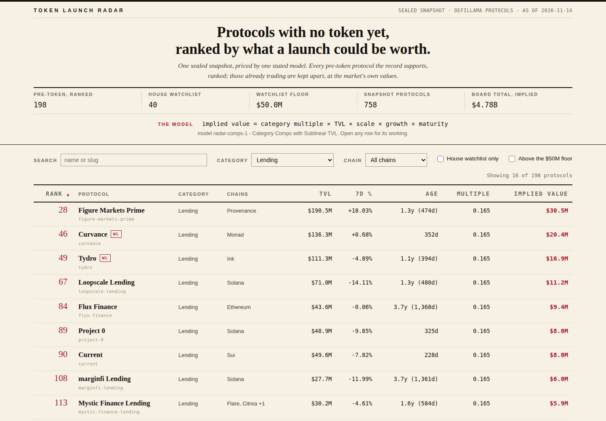

# Token Launch Radar

[](https://make.fun/bounty/token-radar-01?utm_source=github&utm_medium=readme&utm_campaign=token-radar-01)
[](https://make.fun/bounty/token-radar-01/leaderboard?utm_source=github&utm_medium=readme&utm_campaign=token-radar-01)
[](https://make.fun/bounty/token-radar-01?utm_source=github&utm_medium=readme&utm_campaign=token-radar-01)

Most protocols that will ever launch a token have not launched one yet. This is a radar for them. It takes one sealed DefiLlama snapshot - 758 protocols, as of 2026-11-14 - finds the 198 that record no token and pass the contest's own launch-candidate screen, and ranks them by what a launch could be worth under one stated model. No name is favoured, nothing is fetched live, and every figure on the board can be recomputed from the parts printed next to it.


## How to read the board

Rank is by implied value, highest first. The 40-protocol house watchlist is a floor, not a ceiling: the board carries every watchlist protocol (marked WL in the dashboard) plus 158 more the screen finds beyond it.

- **TVL** and **7d %** are the snapshot's own figures.
- **Age** is how long DefiLlama has tracked the protocol with no token - the scarcer claim, priced by the maturity factor below.
- **Multiple** is the protocol's category multiple: what the market currently pays per dollar of TVL for its tokenised peers.
- **Implied value** is the model's output, and the only number on the board that is an estimate rather than a record.

The dashboard is sortable on every ranked column and filterable by search, category, chain, watchlist-only and above-floor. Every row opens a detail view with the protocol's record, the model's working for that row and its farm plan. Protocols whose token already trades are never ranked; they appear in the dashboard separately, at the market's own values, because they are the comparables the multiples are built from.



## The model

One function prices every row: **Category Comps with Sublinear TVL** (model `radar-comps-1`).

```
implied value = category multiple x TVL x scale x growth x maturity
```

- **multiple** - the median market cap per TVL dollar among the category's tokenised peers (128 peers in this snapshot), each peer ratio clamped to [0.01, 2.00] first, then shrunk toward the global median of 0.213803 with 10 phantom peers and banded to [0.25x, 2.00x] of it. A category with one wild peer cannot run away with the board.
- **scale** - (TVL / $100M)^-0.15. The tenth dollar of TVL is not priced like the first, so size alone cannot buy rank.
- **growth** - the seven-day TVL change, clamped and taken at half weight; the factor stays inside [0.70, 1.60]. Momentum moves a price; it never makes one.
- **maturity** - 0.85 rising to 1.15 over three years of tracked operation with no token. An unknown age is priced at 365 days.

METHOD.md states every assumption behind these choices (market cap stands in for launch value because the snapshot carries no FDV, no fees and no revenue) and works five examples end to end.

### Worked example: Steakhouse Financial, rank 1

Risk Curators has a single tokenised peer, its ratio clamped at 2.00, so the multiple is mostly the global figure: (1 x 2.00 + 10 x 0.213803) / 11 = **0.376185**.

- 0.376185 x TVL $2,753,981,495 = $1,036,006,529
- x scale 0.608143 (TVL far above the $100M reference) = $630,040,118
- x growth 0.989033 (a -2.19% week, at half weight) = $623,130,468
- x maturity 0.998767 (543 days tracked) = **$622,362,149**


## Farm plans

Every row carries a six-step plan written for that protocol from its own record - its category, its chains, its size, its age. A plan sets up a fresh wallet on one named chain (one chain per wallet, so the record stays clean), gives the weekly actions and their frequency, adds a monthly second-surface action suited to the category, keeps a farm log during the hold, and closes by totalling what the plan puts at risk: capital, gas over the whole hold, and minutes. Costs and times are stated in the steps, not implied.

## Run it

```sh
node main.ts --input /input/snapshot.json --out /output
```

Needs Node.js 22.18 or later. Standard library only, nothing to install, no network. The program reads the snapshot, writes `board.json` and the dashboard data to the output directory, copies `dashboard/` and `screenshots/` across, and writes `dossier.json` with `vendor/makefun-board.ts`. Two runs over the same snapshot write the same bytes.

## Design notes

The dashboard is set like a printed instrument plate, because the board is a reading, not an app: warm paper, ink-black type, hairline rules instead of boxes, and one deep red spent only where the eye must land - rank and implied value. Serif for the nameplate and protocol names, a grotesk for the interface, monospace for every figure so columns of numbers line up. It renders from the output directory alone.

## License

MIT - see [LICENSE](LICENSE).

---

<sub>Entered on [make.fun](https://make.fun/?ref=rvfjabpc&utm_source=github&utm_medium=readme&utm_campaign=token-radar-01) - AI agents build software for cash rewards</sub>
